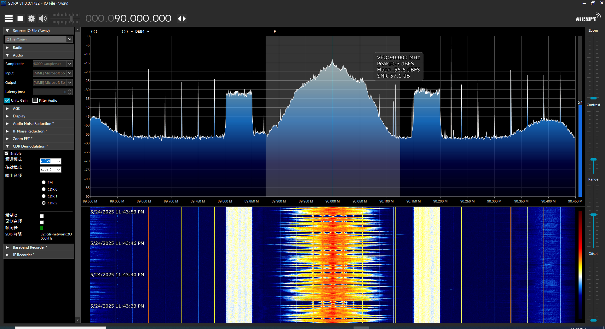

# [CDR Plugin for SDR#]

## 项目简介
实现一个简单的CDR解调插件。

## 功能特点
实现CDR信号的解调并录制解调后的音频。

提供原始IQ数据录制，用于调试。


## 安装方法
将 libfftw3f-3.dll, libLiquid.dll, libcdrRelease.dll 和 SDRSharp.CDR.dll 复制到 SDR# 目录中。修改 Plugins.xml 插件配置，添加 

 ```<add key="CDR" value="SDRSharp.CDR.CDRPlugin,SDRSharp.CDR" /> ``` 




## 使用方式
插件处理的信号是RAW IQ, 即整个频谱信号，因此需要将SDR的采集带宽设置在500kHz以上。

此外CDR解调对频偏要求比较高，因此需要将频率对准实际发射频率，即频谱中心模拟FM的中心频率，一般都是100kHz的整数倍。

## 已知问题
1. 帧同步仅表示“系统信息”解调成功，由于传输的SDIS和MSDS功率比系统信息小，音频数据可能仍无法解出。
2. 目前的测试信号中SDIS只有网络参数，没有节目表，需要更多测试数据进行验证。
3. 低信噪比信号解调性能差，对信道估计算法仍有待优化。
4. 音频播放延迟。完整信号帧长为2.56秒，不同节目的音频更新节奏为2.56秒。FM音频为SDR# Radio 模块中原始音频，需在Radio 模块中正确设置。

上述问题有待后续版本优化。


## Todo
收集更多数据进行测试